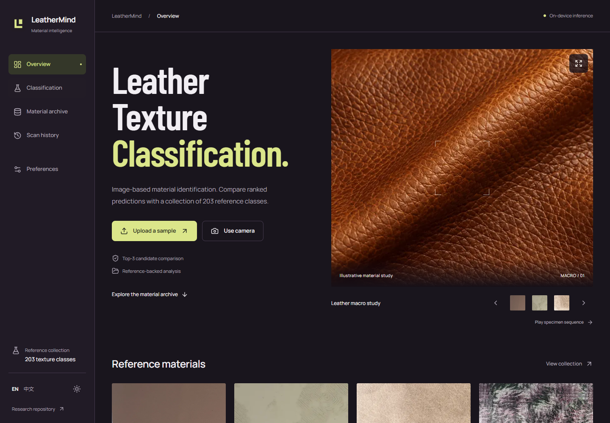
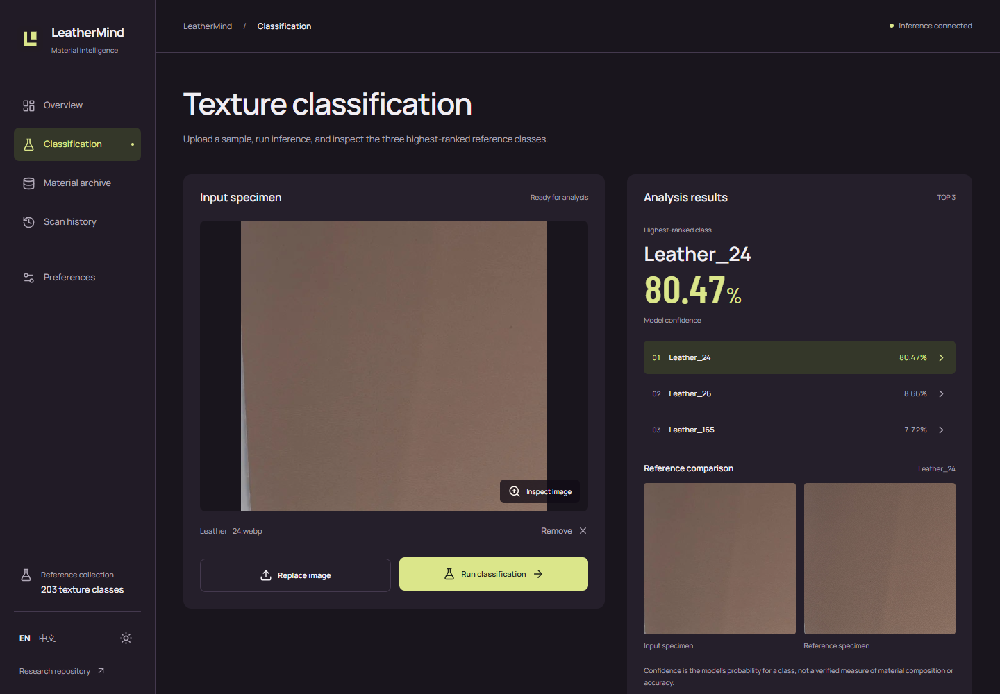
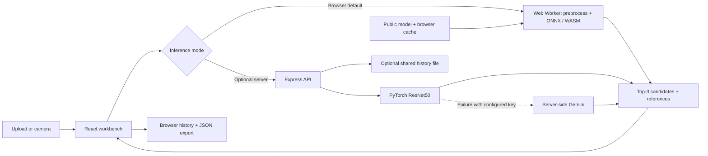

<a id="readme-top"></a>

<div align="center">
  
  <h1>LeatherMind · 革识</h1>
  <p><strong>Leather texture classification, directly in your browser.</strong></p>
  <p>Capture a specimen, compare the Top-3 predictions, and explore 203 reference classes.</p>
  <p><strong>English</strong> · <a href="README.zh-CN.md">简体中文</a></p>
  <p>
    <a href="https://leather.yanyihan.top/">Live Demo</a> ·
    <a href="docs/deployment.md">Deployment Guide</a> ·
    <a href="https://github.com/YanYihann/Leather-Texture-Classifier/issues">Report an Issue</a>
  </p>
  <p>
    
    
    
    <a href="https://github.com/YanYihann/Leather-Texture-Classifier/actions/workflows/deploy-pages.yml"></a>
  </p>
</div>

[](https://leather.yanyihan.top/)

<details>
<summary>Table of contents</summary>

- [About the project](#about-the-project)
- [Features](#features)
- [Getting started](#getting-started)
- [Usage](#usage)
- [How it works](#how-it-works)
- [Project structure](#project-structure)
- [Configuration and deployment](#configuration-and-deployment)
- [Model and evidence](#model-and-evidence)
- [Contributing](#contributing)
- [License and credits](#license-and-credits)

</details>

## About the project

LeatherMind is a web workbench for exploring leather textures through image classification and visual reference comparison. It connects image upload or camera capture, ranked predictions, a searchable specimen archive, and annotated scan records in one interface.

The default app runs a ResNet50 model through **ONNX Runtime Web in a Web Worker**. Images are processed on the visitor's device; no API key or Python installation is needed. An optional Express/PyTorch server supports centralized inference and shared history, with a server-side Gemini fallback.

**203 classes** are dataset identifiers such as `Leather_24`, rather than verified commercial material names. Confidence scores describe the model's output and do not establish material composition or real-world accuracy.

## Features

| Workflow | What you can do |
| --- | --- |
| Capture | Upload JPG, PNG or WebP images, or capture a camera frame with adjustable zoom. |
| Classify | Follow model download progress, run on-device inference, cancel and retry. |
| Compare | Inspect the three highest-ranked classes, confidence scores and reference specimens. |
| Explore | Search 203 reference classes, paginate the archive and save favorites. |
| Record | Search scans, edit notes, select and delete records, and export results or history as JSON. |
| Personalize | Switch English/Chinese and dark/light themes; preferences persist locally. |
| Deploy | Serve the browser app statically, or enable the optional Python inference server. |



*Repository screenshots show an earlier verified build. The overview's macro leather image is illustrative; archive specimens are derived from the local reference dataset.*

## Getting started

### Prerequisites

- **Node.js 22+** and npm.
- A browser with WebAssembly, Web Workers and OffscreenCanvas support.
- Internet access for the initial model download: approximately **95.6 MB**, plus **14.2 MB** of WebAssembly runtime.

### Run the browser app

```bash
git clone https://github.com/YanYihann/Leather-Texture-Classifier.git
cd Leather-Texture-Classifier
npm ci
npm run dev
```

Open **http://localhost:3000**. The repository includes the ONNX model, runtime and optimized reference images. Environment configuration is optional for this default mode.

If you have existing `.env` or `.env.local` files, ensure `VITE_INFERENCE_MODE=browser`. A fresh clone uses browser inference automatically.

### Check and build

```bash
npm run lint
npm run build
npm run preview
```

`lint` runs the TypeScript checker. The production frontend is written to `dist/`; preview normally serves it at **http://localhost:4173**.

## Usage

1. Choose **Upload a sample** or **Use camera** from the overview.
2. Select an image or capture a frame, then choose **Run classification**.
3. On first use, wait for model download and initialization. Later runs can reuse the cached model when browser storage permits.
4. Select a candidate to compare your image with its reference specimen.
5. Review **Scan history** to add notes or export JSON. Browse **Material archive** to search classes and favorite specimens.

Camera access requires **HTTPS or localhost** and browser permission. Plain HTTP over a LAN may not provide camera access.

Browser mode keeps up to **30 recent records**, subject to available storage. Clearing site data removes history, preferences, favorites and the model cache. Export records you want to retain. Server mode can send images to the configured server and, if local inference fails and a key is configured, Gemini.

## How it works



The frontend uses **React 19, TypeScript, Vite 6, Tailwind CSS 4, Motion and Lucide**. Browser inference uses **ONNX Runtime Web**; the optional server uses **Express, PyTorch, torchvision and Pillow**.

## Project structure

```text
Leather-Texture-Classifier/
├── src/
│   ├── App.tsx                   # Workbench, archive, history and preferences
│   ├── data/materials.json       # Ordered class manifest and specimen provenance
│   └── services/                 # Worker inference, API, image and asset helpers
├── public/
│   ├── models/                   # Deployable float32 ONNX model
│   ├── runtime/                  # Matching ONNX WebAssembly runtime
│   ├── materials/                # Reference specimens
│   └── material-thumbnails/      # Archive thumbnails
├── scripts/                      # Model export and asset preparation tools
├── docs/
│   ├── deployment.md             # Static, Docker and server deployment
│   ├── model/                    # Model notes and retained export validation
│   ├── images/                   # README screenshots
│   ├── research/                 # Existing literature review notes
│   └── portfolio/                # Existing portfolio source notes
├── server.ts                     # Optional inference and history API
├── inference.py                  # Persistent PyTorch inference worker
├── PRODUCT.md / DESIGN.md        # Product constraints and design reference
└── .github/workflows/            # Type check, build and Pages deployment
```

Training inputs, original `.pth` weights, `.env` secrets, user history and local build/review artifacts are kept outside Git. The public ONNX model and optimized references are included so the default application works after cloning.

## Configuration and deployment

Copy `.env.example` to `.env` only if you need custom settings (`cp .env.example .env`, or `Copy-Item .env.example .env` in PowerShell).

| Variable | Default / purpose |
| --- | --- |
| `VITE_INFERENCE_MODE` | `browser`; set to `server` to call the inference API. |
| `VITE_BASE_PATH` | `/`; use `/Leather-Texture-Classifier/` for project-path Pages hosting. |
| `VITE_API_BASE_URL` | Empty for same-origin server requests. |
| `PORT` | Server port, default `3000`. |
| `PYTHON_EXECUTABLE` | Optional Python command or executable path for server mode. |
| `MODEL_PATH`, `DATASET_DIR` | Paths to separately provisioned PyTorch weights and reference dataset. |
| `HISTORY_FILE`, `HISTORY_LIMIT` | Optional shared-history location and cap (maximum `1000`). |
| `GEMINI_API_KEY`, `GEMINI_MODEL` | Optional server-only cloud fallback; default model `gemini-2.5-flash`. |

`VITE_*` variables are public build-time configuration. Keep API keys on the server. For a separate API origin, configure CORS or a reverse proxy; this server does not enable cross-origin access by default.

- **Static deployment:** deploy `dist/` with Vercel or another static host. `vercel.json` is included.
- **GitHub Pages:** the included workflow builds browser mode with the repository base path. Enable Pages with **GitHub Actions** as its source.
- **Optional server:** install `requirements.txt`, provision the original weights, set server mode, then run `npm run dev:server` or build and run `npm start`.
- **Docker / Render:** see the [deployment guide](docs/deployment.md), including model mounts and history persistence.

## Model and evidence

The bundled float32 ResNet50 model accepts an RGB image after antialiased resize to 256, a 224 × 224 center crop, and ImageNet normalization. Its 203 output positions follow the manifest order.

The retained [export validation report](docs/model/export-validation.json) compares PyTorch and ONNX on **203 reference images**: all Top-1 predictions and all ordered Top-3 predictions matched, with maximum probability difference approximately **1.02 × 10⁻⁵**. This measures conversion equivalence on those samples; it is **not an independent accuracy benchmark**. Training code and a held-out evaluation protocol are not included.

See [model and asset notes](docs/model/README.md) for the model checksum, class ordering, runtime provenance, re-export commands and limitations. Existing [literature notes](docs/research/literature-review.md) are background material, not evidence of this model's performance.

## Contributing

Open an [issue](https://github.com/YanYihann/Leather-Texture-Classifier/issues) or fork the repository and submit a pull request. Run `npm run lint` and `npm run build`, and include screenshots for interface changes. For model changes, document the class mapping, preprocessing and validation evidence. Keep secrets, user records and training inputs out of commits.

Useful next steps include a reproducible training/evaluation package and authenticated, database-backed shared history. The optional server currently has no user authentication; keep shared-history deployments within a trusted environment or add access control.

## License and credits

No project-wide license has been declared. Code, model weights and reference images do not currently carry a blanket reuse grant; dependency licenses apply separately. ONNX Runtime's notice is included in [public/runtime/LICENSE.txt](public/runtime/LICENSE.txt).

Maintained by [@YanYihann](https://github.com/YanYihann).

README structure is adapted from [Best-README-Template](https://github.com/othneildrew/Best-README-Template), with visual presentation inspired by [awesome-readme](https://github.com/matiassingers/awesome-readme). Thanks to the React, Vite, ONNX Runtime, PyTorch and other dependency maintainers.

<p align="right"><a href="#readme-top">Back to top ↑</a></p>
