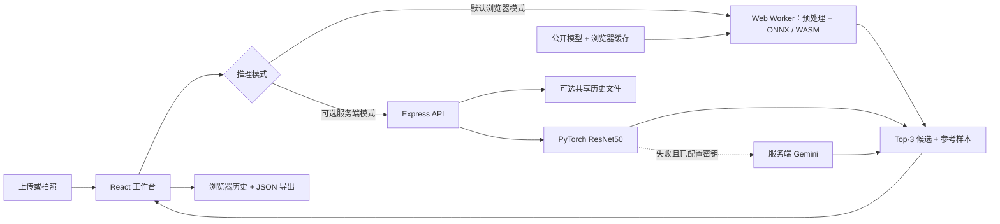

<a id="readme-top"></a>

<div align="center">
  
  <h1>LeatherMind · 革识</h1>
  <p><strong>直接在浏览器中完成皮革纹理分类。</strong></p>
  <p>拍摄样本、对比 Top-3 预测，并浏览 203 个参考类别。</p>
  <p><a href="README.md">English</a> · <strong>简体中文</strong></p>
  <p>
    <a href="https://leather.yanyihan.top/">在线体验</a> ·
    <a href="docs/deployment.md">部署指南</a> ·
    <a href="https://github.com/YanYihann/Leather-Texture-Classifier/issues">问题反馈</a>
  </p>
  <p>
    
    
    
    <a href="https://github.com/YanYihann/Leather-Texture-Classifier/actions/workflows/deploy-pages.yml"></a>
  </p>
</div>

[](https://leather.yanyihan.top/)

<details>
<summary>目录</summary>

- [关于项目](#关于项目)
- [功能](#功能)
- [快速开始](#快速开始)
- [使用方法](#使用方法)
- [工作原理](#工作原理)
- [项目结构](#项目结构)
- [配置与部署](#配置与部署)
- [模型与验证依据](#模型与验证依据)
- [参与贡献](#参与贡献)
- [许可证与鸣谢](#许可证与鸣谢)

</details>

## 关于项目

LeatherMind 是一个将图像分类与参考样本比对结合的皮革纹理 Web 工作台。它把图片上传或拍照、候选类别排序、参考样本检索和带备注的识别记录连接成完整流程。

默认版本通过 **ONNX Runtime Web，在 Web Worker 中运行 ResNet50 模型**。图片在访问者设备上处理，无需 API Key 或 Python 环境。项目同时保留可选的 Express/PyTorch 服务端模式，支持集中推理、共享历史，以及服务端 Gemini 回退。

**203 个类别**对应 `Leather_24` 等数据集编号，并不代表经过确认的商业材质名称。置信度是模型输出，不能直接证明材质成分或实际识别准确率。

## 功能

| 流程 | 支持能力 |
| --- | --- |
| 采集 | 上传 JPG、PNG、WebP 图片，或使用相机取景、调整缩放并拍摄。 |
| 分类 | 查看模型下载进度，执行设备本地推理，支持取消与重试。 |
| 比对 | 查看 Top-3 类别、置信度和对应参考样本。 |
| 浏览 | 检索 203 个参考类别、分页浏览材质档案、收藏样本。 |
| 记录 | 搜索历史、编辑备注、选择和删除记录，将结果或全部历史导出为 JSON。 |
| 偏好 | 切换中英文和明暗主题，偏好保存在本地。 |
| 部署 | 以静态站点运行浏览器版本，或启用可选 Python 推理服务。 |


*截图来自此前已验证的构建。首页皮革微距图用于视觉展示；材质档案中的样本来自本地参考数据集。*

## 快速开始

### 环境要求

- **Node.js 22+** 和 npm。
- 支持 WebAssembly、Web Workers 和 OffscreenCanvas 的浏览器。
- 首次推理需要下载约 **95.6 MB** 模型及 **14.2 MB** WebAssembly 运行时。

### 启动浏览器版本

```bash
git clone https://github.com/YanYihann/Leather-Texture-Classifier.git
cd Leather-Texture-Classifier
npm ci
npm run dev
```

访问 **http://localhost:3000**。仓库包含 ONNX 模型、运行时和优化后的参考图，默认模式无需配置环境变量。

如果本机已有 `.env` 或 `.env.local`，请确认 `VITE_INFERENCE_MODE=browser`。全新克隆默认使用浏览器推理。

### 检查与构建

```bash
npm run lint
npm run build
npm run preview
```

`lint` 执行 TypeScript 类型检查；构建产物位于 `dist/`，预览通常使用 **http://localhost:4173**。

## 使用方法

1. 在首页选择 **上传样本** 或 **使用相机**。
2. 选择图片或拍摄画面，然后点击 **运行分类**。
3. 首次使用需等待模型下载和初始化；浏览器存储允许时，后续可复用缓存。
4. 点击候选类别，对照输入图片与参考样本。
5. 在 **识别历史** 中编辑备注或导出 JSON；在 **材质档案** 中检索类别并收藏样本。

相机需要 **HTTPS 或 localhost** 以及浏览器授权。通过局域网普通 HTTP 访问时，相机可能不可用。

浏览器模式最多保存 **30 条近期记录**，实际数量受存储空间限制。清除站点数据会删除历史、偏好、收藏和模型缓存，需要长期保留的记录请及时导出。服务端模式会将图片发送到配置的后端；若本地模型失败且已配置密钥，还可能发送至 Gemini。

## 工作原理



前端使用 **React 19、TypeScript、Vite 6、Tailwind CSS 4、Motion 和 Lucide**；浏览器推理使用 **ONNX Runtime Web**；可选服务端使用 **Express、PyTorch、torchvision 和 Pillow**。

## 项目结构

```text
Leather-Texture-Classifier/
├── src/
│   ├── App.tsx                   # 工作台、档案、历史与偏好
│   ├── data/materials.json       # 有序类别清单与样本来源
│   └── services/                 # Worker 推理、API、图像与资源路径工具
├── public/
│   ├── models/                   # 可部署的 float32 ONNX 模型
│   ├── runtime/                  # 匹配版本的 WebAssembly 运行时
│   ├── materials/                # 参考样本
│   └── material-thumbnails/      # 档案缩略图
├── scripts/                      # 模型导出与资源准备工具
├── docs/
│   ├── deployment.md             # 静态、Docker 和服务端部署
│   ├── model/                    # 模型说明与已有导出验证报告
│   ├── images/                   # README 截图
│   ├── research/                 # 已有文献阅读笔记
│   └── portfolio/                # 已有作品集素材笔记
├── server.ts                     # 可选推理与共享历史 API
├── inference.py                  # 常驻 PyTorch 推理进程
├── PRODUCT.md / DESIGN.md        # 产品约束与设计参考
└── .github/workflows/            # 类型检查、构建与 Pages 部署
```

训练输入、原始 `.pth` 权重、`.env` 密钥、用户历史和本地构建/审查产物保留在本地。仓库包含公开 ONNX 模型与优化参考图，默认应用克隆后即可运行。

## 配置与部署

需要自定义配置时，将 `.env.example` 复制为 `.env`：使用 `cp .env.example .env`，PowerShell 使用 `Copy-Item .env.example .env`。

| 变量 | 默认值 / 用途 |
| --- | --- |
| `VITE_INFERENCE_MODE` | 默认 `browser`，设为 `server` 后调用推理 API。 |
| `VITE_BASE_PATH` | 默认 `/`；项目路径 Pages 使用 `/Leather-Texture-Classifier/`。 |
| `VITE_API_BASE_URL` | 默认留空，服务端请求使用同源地址。 |
| `PORT` | 服务端端口，默认 `3000`。 |
| `PYTHON_EXECUTABLE` | 可选 Python 命令或解释器路径。 |
| `MODEL_PATH`、`DATASET_DIR` | 另行准备的 PyTorch 权重和参考数据集路径。 |
| `HISTORY_FILE`、`HISTORY_LIMIT` | 共享历史文件位置和数量上限，最多 `1000` 条。 |
| `GEMINI_API_KEY`、`GEMINI_MODEL` | 可选服务端云回退；默认模型为 `gemini-2.5-flash`。 |

`VITE_*` 是公开的构建时配置，API Key 应保留在服务端。API 部署在不同源时，需要配置 CORS 或反向代理；当前服务器默认未开启跨域访问。

- **静态部署：** 将 `dist/` 部署到 Vercel 或其他静态托管平台，仓库包含 `vercel.json`。
- **GitHub Pages：** 工作流自动使用浏览器模式和仓库子路径构建；Pages 来源请选择 **GitHub Actions**。
- **可选服务端：** 安装 `requirements.txt`、准备原始权重并设置服务端模式，运行 `npm run dev:server`，或构建后运行 `npm start`。
- **Docker / Render：** 模型挂载与历史持久化参见 [部署指南](docs/deployment.md)。

## 模型与验证依据

随仓库发布的 float32 ResNet50 模型使用 RGB 输入，执行抗锯齿 Resize(256)、224 × 224 中心裁剪与 ImageNet 标准化，203 个输出位置按类别清单顺序映射。

已有 [导出验证报告](docs/model/export-validation.json) 对 **203 张参考图**进行了 PyTorch 与 ONNX 比较：Top-1 预测和有序 Top-3 预测全部一致，最大概率差约 **1.02 × 10⁻⁵**。这说明这些样本上的转换一致性，**不等于独立测试集准确率**。仓库尚未包含训练代码和独立评估协议。

模型校验和、类别顺序、运行时来源、重新导出命令和限制见 [模型与资源说明](docs/model/README.md)。已有 [文献笔记](docs/research/literature-review.md) 是背景材料，不构成本模型性能的验证依据。

## 参与贡献

欢迎通过 [Issues](https://github.com/YanYihann/Leather-Texture-Classifier/issues) 或 Fork 后提交 Pull Request。提交前运行 `npm run lint` 与 `npm run build`；界面变更请附截图，模型变更请说明类别映射、预处理和验证依据。请勿提交密钥、用户记录和训练输入。

后续可补充可复现的训练/评估包，以及带身份验证和数据库的共享历史服务。当前可选服务端没有用户认证，共享历史应部署在可信环境中，或自行增加访问控制。

## 许可证与鸣谢

项目尚未声明统一许可证，代码、模型和参考图目前没有整体再利用授权；第三方依赖分别遵循自身许可证。ONNX Runtime 许可说明见 [public/runtime/LICENSE.txt](public/runtime/LICENSE.txt)。

维护者：[@YanYihann](https://github.com/YanYihann)。

README 结构参考 [Best-README-Template](https://github.com/othneildrew/Best-README-Template)，视觉展示参考 [awesome-readme](https://github.com/matiassingers/awesome-readme)。感谢 React、Vite、ONNX Runtime、PyTorch 及其他依赖的维护者。

<p align="right"><a href="#readme-top">回到顶部 ↑</a></p>
